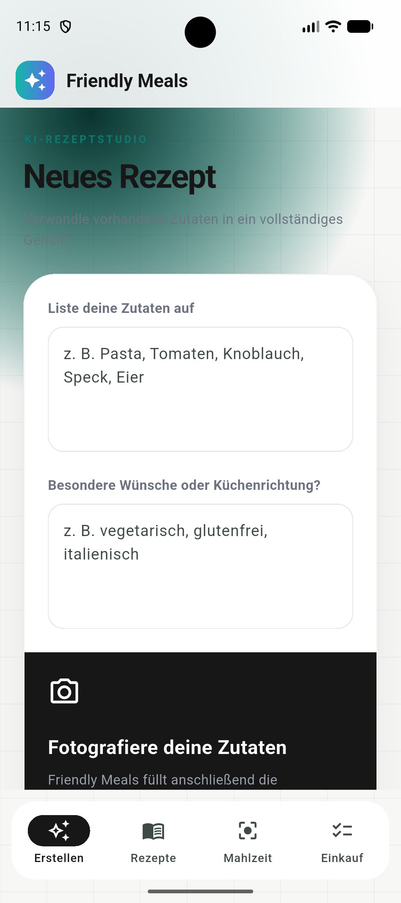
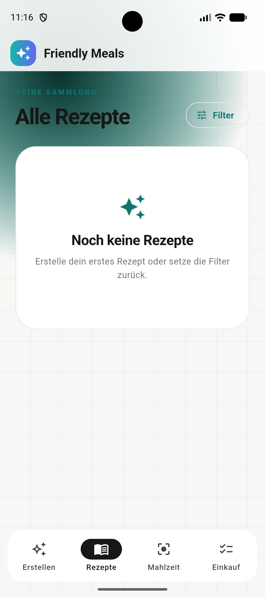
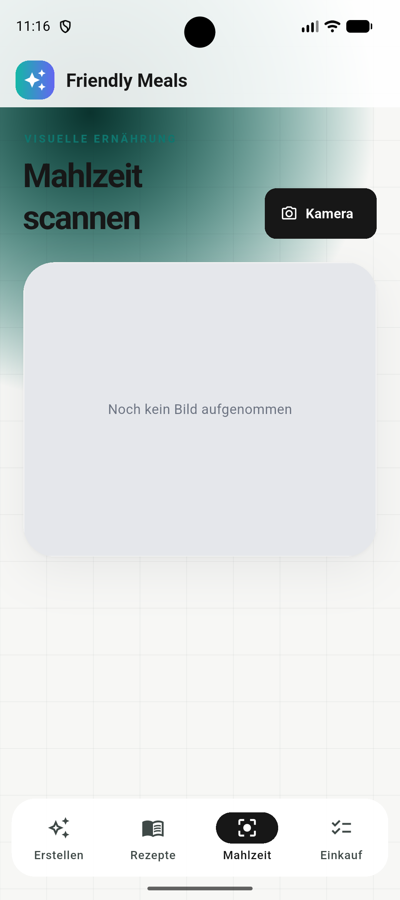
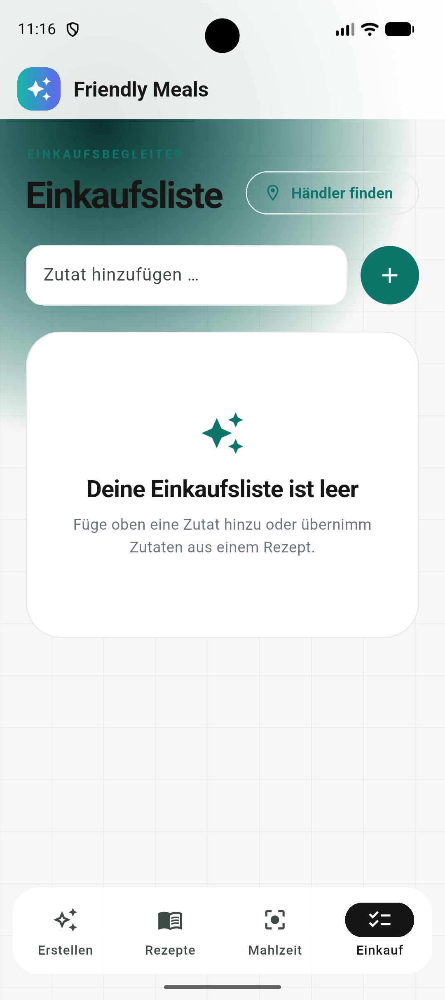

# Friendly Meals Flutter

Eine kompakte Flutter-App auf Deutsch für Rezepte, Einkaufsliste, Meal-Scan und Kochhilfe.

Start: `flutter pub get && dart run flutter_launcher_icons && flutter run`

Die Rezeptfilter öffnen sich über „Filter“ als ziehbares Sheet mit drei Höhenstufen.
Die schwebende Aktionsleiste bleibt beim Scrollen sichtbar und rückt bei geöffneter
Tastatur nach oben. „Filter anwenden“ speichert die Auswahl, „Zurücksetzen“ löscht
die gespeicherten Filter; Zurück, die System-Zurück-Taste und Tippen außerhalb
verwerfen den Entwurf. Die bisherige Route `/recipes/filter` bleibt erreichbar.

Inspiriert vom [Formsheet-Footer-Demo von kitten](https://github.com/kitten/expo-55-demos/tree/main/apps/formsheet-footer),
mit Flutter-Bordmitteln umgesetzt, ohne zusätzliche Abhängigkeiten.

| Startansicht | Rezepte | Details | Einkaufsliste |
| --- | --- | --- | --- |
|  |  |  |  |
